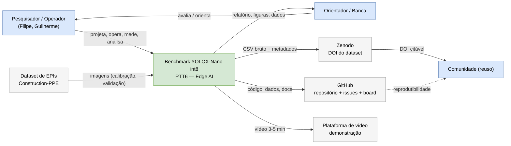
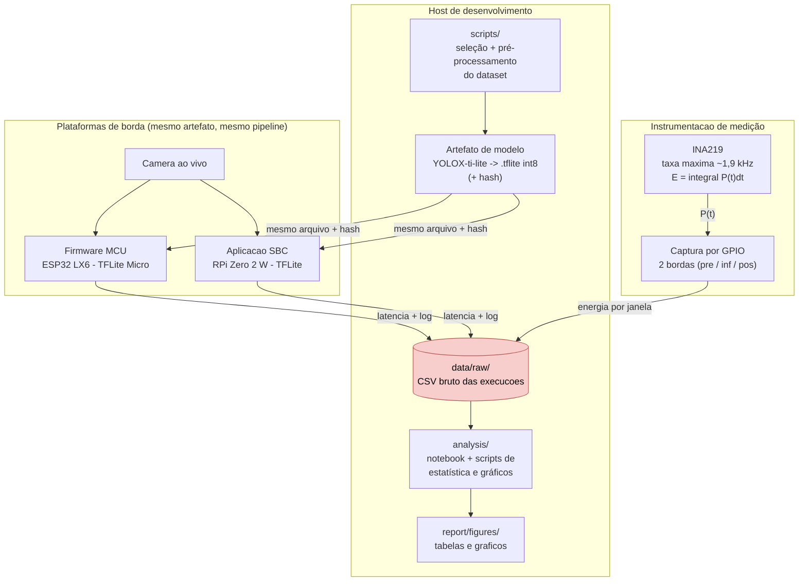

# 01 — Contexto e Containers (C4)

> Diagramas de **contexto (nível 1)** e **containers (nível 2)** do benchmark.

## Nível 1 — Contexto do sistema

Quem usa o benchmark e de quais sistemas externos ele depende.

**Leitura:** o sistema é um **artefato de medição** — não presta serviço a usuário final em tempo real;
seu produto é **evidência** (relatório, dataset, vídeo) para o orientador e para a comunidade.

## Nível 2 — Containers

Como o sistema é decomposto por responsabilidade (o que roda à noite, o que roda na borda).

**Regra da comparabilidade (protocolo §3):** o container `Artefato de modelo` é **único** e alimenta as
duas plataformas; o pipeline de `prep` + `fw`/`sbc` deve ser funcionalmente idêntico.
