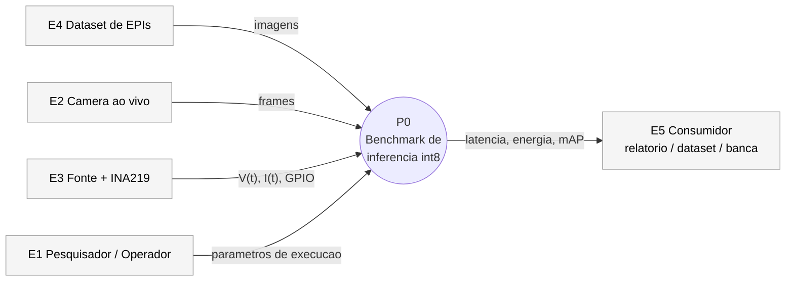
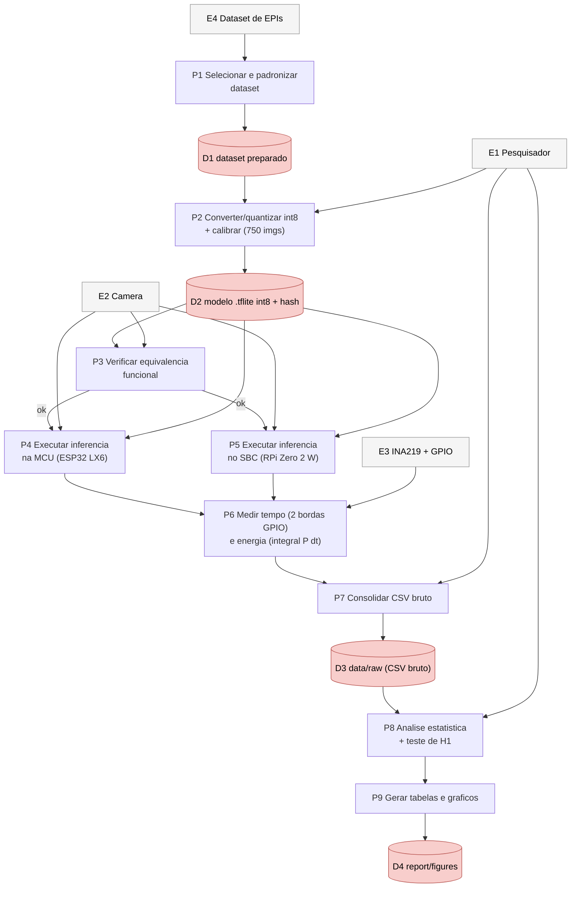

# 02 — Fluxo de Dados (DFD)

> Diagrama de Fluxo de Dados em dois níveis: **nível 0** (contexto) e **nível 1**
> (decomposição dos processos). Notação: `P` = processo, `D` = depósito de dados,
> `E` = entidade externa.

## Nível 0 — Panorama

## Nível 1 — Decomposição

**Notas de rigor:**
- **P2** produz um **único** artefato usado nas duas plataformas (hash registrado) — isola o hardware.
- **P3** é obrigatório: sem equivalência funcional a comparação é inválida (protocolo §3, issue #7).
- **P6** é a fronteira da medição: a janela de energia é delimitada pelas **duas bordas de GPIO**, que
  também separam as três fases (pré / inferência / pós).
- **P7** preserva o **bruto** (fonte da verdade); **P8/P9** só derivam dele.
