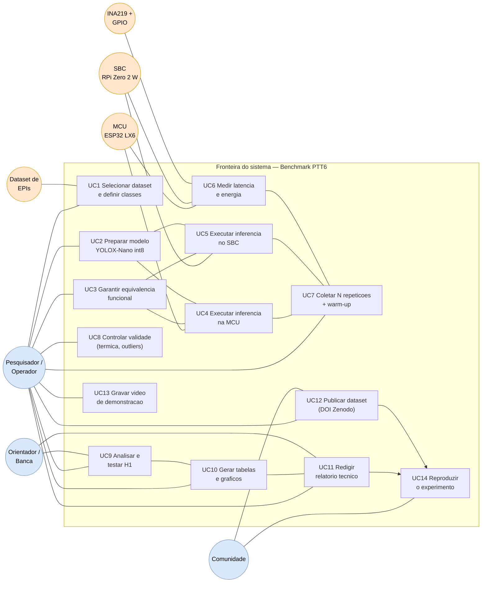

# 03 — Casos de Uso

> O Mermaid **não** tem um tipo nativo de diagrama de casos de uso UML; usamos `flowchart` com
> **atores** (fora do retângulo) e a **fronteira do sistema** (subgrafo). O mapeamento para issues
> aparece na tabela final.

## Diagrama de casos de uso

## Catálogo de casos de uso

| ID | Caso de uso | Ator primário | Atores de apoio | Issue | Entregável |
|----|-------------|---------------|-----------------|-------|------------|
| UC1 | Selecionar dataset e definir classes | Pesquisador | Dataset EPIs | #4, #20 | `docs/dataset.md` |
| UC2 | Preparar modelo YOLOX-Nano int8 | Pesquisador | — | #2, #5, #6 | Artefato `.tflite` + hash |
| UC3 | Garantir equivalência funcional | Pesquisador | MCU, SBC | #7 | Evidência em `scripts/` |
| UC4 | Executar inferência na MCU | Pesquisador | MCU (LX6) | #5 | Log + latência |
| UC5 | Executar inferência no SBC | Pesquisador | SBC | #6 | Log + latência |
| UC6 | Medir latência e energia | Pesquisador | INA219 + GPIO | #8 | `E`, `t` por execução |
| UC7 | Coletar N repetições + warm-up | Pesquisador | MCU, SBC | #10 | `data/raw/*.csv` |
| UC8 | Controlar validade (térmica, outliers) | Pesquisador | — | #11 | Notas de coleta |
| UC9 | Analisar e testar H1 | Pesquisador | — | #12 | Notebook de análise |
| UC10 | Gerar tabelas e gráficos | Pesquisador | — | #13 | `report/figures/` |
| UC11 | Redigir relatório técnico | Pesquisador | Orientador | #14 | Relatório (produto principal) |
| UC12 | Publicar dataset (DOI Zenodo) | Pesquisador | Comunidade | #16 | DOI citável |
| UC13 | Gravar vídeo de demonstração | Pesquisador | — | #17 | Vídeo 3–5 min |
| UC14 | Reproduzir o experimento | Comunidade | — | #15 | README de reprodutibilidade |

**Observação:** UC4/UC5 são o **mesmo caso de uso** em plataformas distintas — a diferença é o
hardware/runtime de destino, não a lógica. Isso é o que torna a comparação válida (regra da
comparabilidade).
