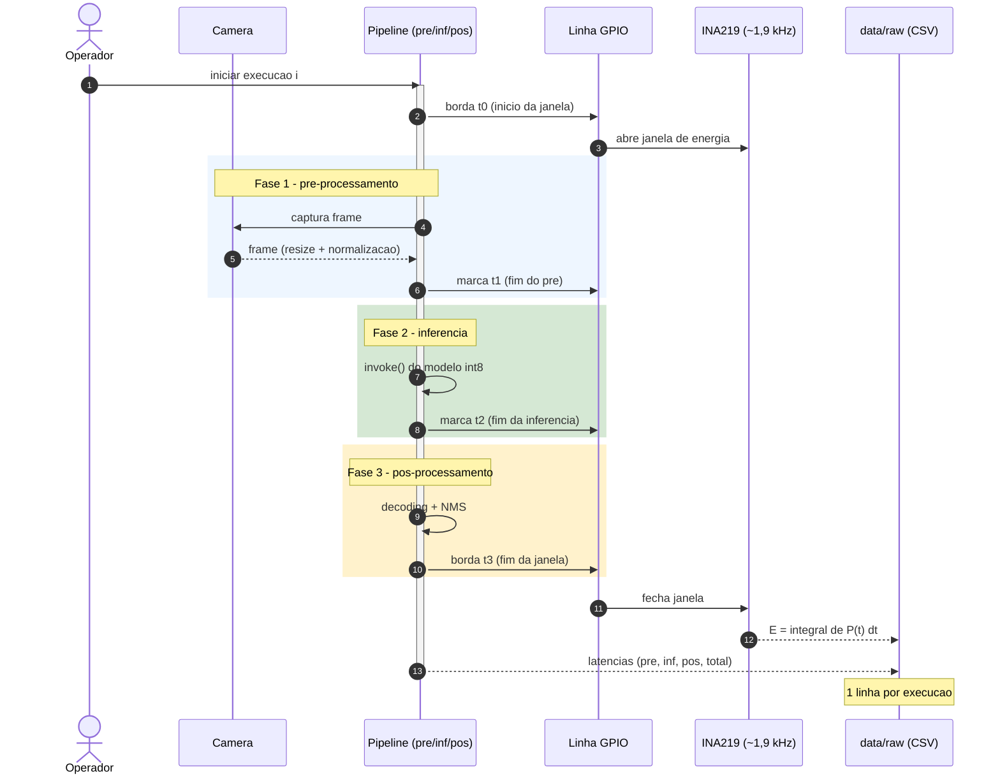

# 04 — Sequência de Execução

> Como **uma repetição medida** acontece no tempo, do ponto de vista dos componentes.
> A **janela de energia** é delimitada por **bordas de GPIO** e as **três fases** (pré / inferência /
> pós) são separadas para permitir reanálise (protocolo §5 e §6).

## Sequência de uma repetição



## Linha do tempo da janela

```
 t0                 t1                      t2                 t3
  |----- pre --------|------ inferencia -----|----- pos --------|
  |<-------------------- janela de energia ------------------->|
```

- **Latência** reportada: `pre + inferência + pós` (D5) — e **também** as 3 fases separadas.
- **Energia**: `E = ∫ P(t)·dt` integrada em `[t0, t3]` (inclui o consumo parado — D6).
- **Duas bordas GPIO** delimitam a janela; marcas internas (`t1`, `t2`) separam as fases.

## Execução em lote (a sessão completa)

```mermaid
sequenceDiagram
  autonumber
  actor OP as Operador
  participant PLAT as Plataforma (MCU ou SBC)
  participant HOST as Host (coleta)

  loop Warm-up (definido pelo dado; piso 5)
    OP->>PLAT: repeticao de aquecimento
    PLAT-->>HOST: log (nao entra na analise)
  end
  Note over OP,HOST: checar estabilidade (variacao abaixo de 2%) e temperatura
  loop N repetições válidas (piso 30)
    OP->>PLAT: repeticao valida (janela medida)
    PLAT-->>HOST: latencia + energia -> CSV
  end
  Note over OP,HOST: pausa de resfriamento entre baterias / troca de plataforma
```

**Pontos de controle:** aquecimento antes de contar (D22), **N** definido por piloto/CV (D19),
pausas de resfriamento e registro de temperatura (ameaça térmica).
