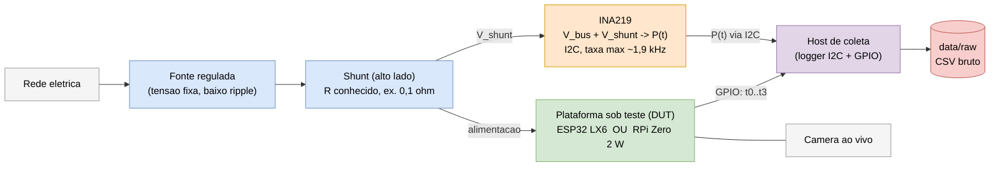
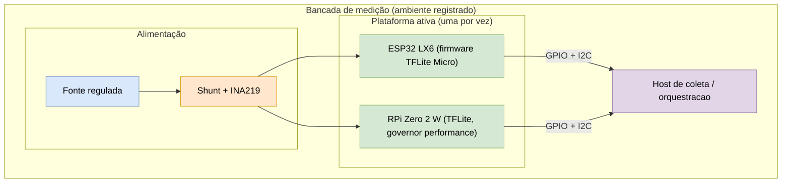

# 05 — Implantação e Hardware

> Como o **INA219** e as **linhas de GPIO** se conectam à plataforma sob teste (DUT) e ao host.
> O esquema é o mesmo para as duas plataformas (fonte regulada + sensor inline).

## Esquema de alimentação e medição

## Topologia de conexões

| Bloco | Papel | Observação de rigor |
|---|---|---|
| Fonte regulada | tensão estável | registrar tensão; verificar estabilidade (issue #8) |
| Shunt + INA219 | medir `V` e `I` inline | INA219 mede **V e I em instantes diferentes** → erro declarado como limitação |
| Linha GPIO (t0..t3) | delimitar a janela e as fases | **sem overhead de software** na cronometragem |
| DUT | ESP32 LX6 **ou** RPi Zero 2 W | medir **uma plataforma por vez**, mesmo esquema |
| Host de coleta | agregar `P(t)` e latências | timestamp comum; uma linha por execução em `data/raw` |
| Câmera | entrada ao vivo | fixar resolução/formato/buffers iguais nas duas pontas |

## Diagrama de implantação (nós físicos)

> **Plano B desta visão:** se o INA219 não estiver disponível/confiável, o bloco `Shunt + INA219` é
> substituído por **estimativa por datasheet × tempo medido** (ver [07 — Fluxo do Plano B](07-fluxo-plano-b.md)),
> mantendo fonte, GPIO e host.
