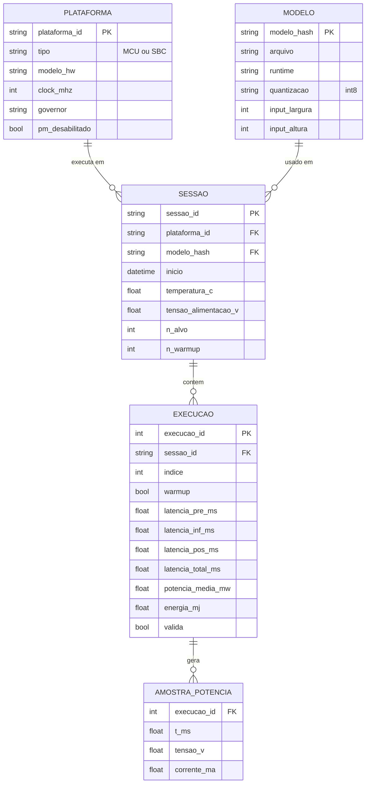

# 06 — Modelo de Dados (CSV bruto)

> Estrutura de `data/raw/*.csv` (fonte da verdade) e das entidades derivadas. O CSV é **long-form**:
> **uma linha por execução**. Amostras de potência de alta taxa (opcional) ficam em arquivo separado.

## Modelo entidade-relacionamento

## Dicionário de dados — `data/raw/<plataforma>.csv` (tabela-fato `EXECUCAO`)

| Coluna | Tipo | Unidade | Descrição | Origem |
|---|---|---|---|---|
| `plataforma_id` | string | — | `mcu_esp32_lx6` ou `sbc_rpi_zero_2w` | configuração |
| `sessao_id` | string | — | agrupa uma bateria/sessão de coleta | orquestrador |
| `execucao_id` | int | — | índice global da execução | orquestrador |
| `indice` | int | — | posição na sessão (1..N) | orquestrador |
| `warmup` | bool | — | `true` se descartada no aquecimento | orquestrador |
| `latencia_pre_ms` | float | ms | fase de pré-processamento | GPIO t0→t1 |
| `latencia_inf_ms` | float | ms | fase de inferência | GPIO t1→t2 |
| `latencia_pos_ms` | float | ms | fase de pós-processamento | GPIO t2→t3 |
| `latencia_total_ms` | float | ms | pré + inferência + pós | GPIO t0→t3 |
| `potencia_media_mw` | float | mW | média de `P(t)` na janela | INA219 |
| `energia_mj` | float | mJ | `E = ∫ P(t)·dt` na janela | INA219 + GPIO |
| `modelo_hash` | string | — | hash do artefato `.tflite` | artefato de modelo |
| `temperatura_c` | float | °C | temperatura registrada na sessão | sensor/ambiente |
| `tensao_alimentacao_v` | float | V | tensão da fonte | INA219/bancada |
| `valida` | bool | — | `false` se descartada por critério de QA | análise (não destrutivo) |
| `observacao` | string | — | anomalias/notas | operador |

## Datasets derivados

| Arquivo | Conteúdo | Regra |
|---|---|---|
| `data/raw/*.csv` | execuções cruas (uma linha por execução) | **nunca** editar manualmente |
| `data/processed/summary.csv` | mediana, IQR, média ± dp, IC 95% por plataforma/métrica | derivado por script |
| `data/processed/h1_test.csv` | Mann-Whitney U, tamanho de efeito, IC bootstrap | derivado por script |

**Princípios:** o bruto é imutável e contém o suficiente para **reanálise**; descartes (warm-up/QA)
são **marcados** (`warmup`, `valida`) e não apagados — preservando a rastreabilidade exigida pelo
protocolo (§5 e §8) e pelo entregável de "dados brutos".
