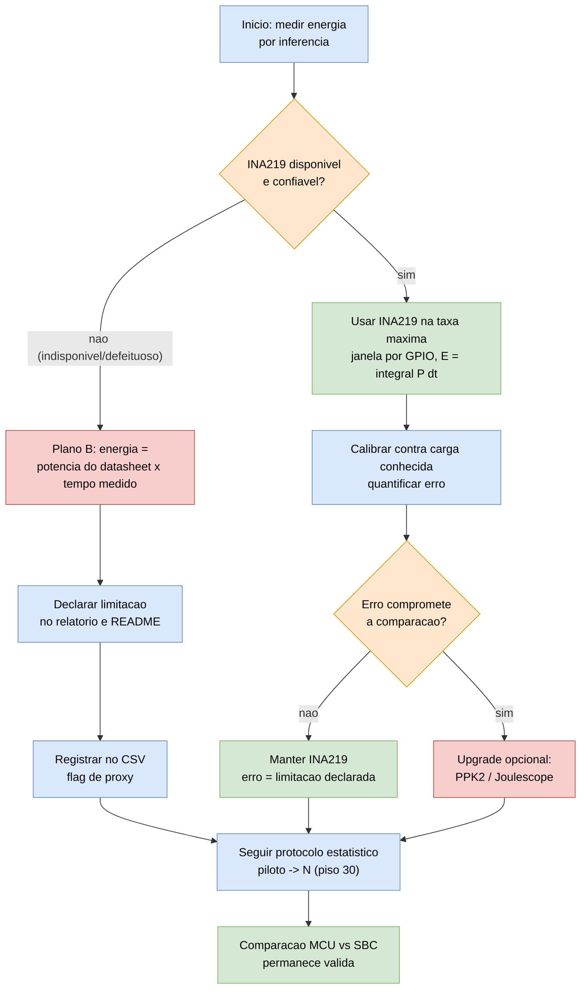
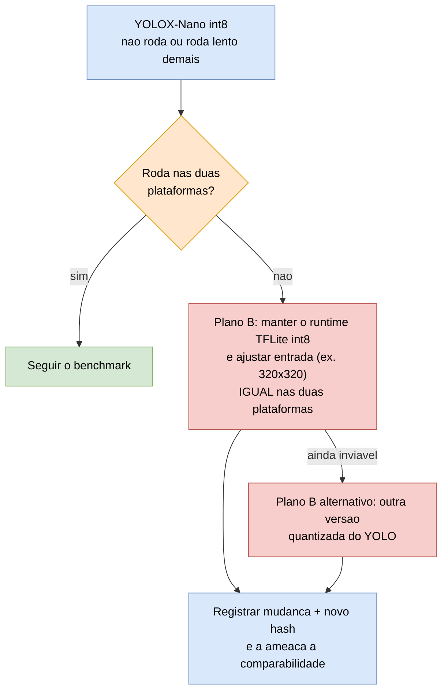

# 07 — Fluxo do Plano B

> Árvore de decisão das contingências (protocolo §10 e §11). Regra de ouro: **nunca bloquear a entrega**
> — quando um risco se materializa, aciona-se o caminho alternativo **declarando a limitação**.

## Decisão: instrumento de energia

## Decisão: modelo não performa em uma plataforma

## Matriz de riscos → resposta

| Risco | Prob. | Impacto | Resposta | Onde registrar |
|---|---|---|---|---|
| Medidor físico indisponível/defeituoso | média | alto | datasheet × tempo medido + limitação | CSV (flag), relatório, README |
| Modelo não performa em um dispositivo | média | alto | ajuste de entrada idêntico ou outra versão quantizada | relatório, artefato (hash) |
| Throttling térmico (SBC) | média | alto | governor `performance`, heatsink, pausas, registrar temp. | notas de coleta (#11) |
| PM/DFS da MCU alterando medição | média | alto | desabilitar PM, travar 240 MHz, registrar `sdkconfig` | `sdkconfig`, relatório |
| Sem baseline publicado do YOLOX-Nano | alta | médio | rigor de reprodutibilidade + exemplos análogos + dataset como contribuição | relatório (D16) |
