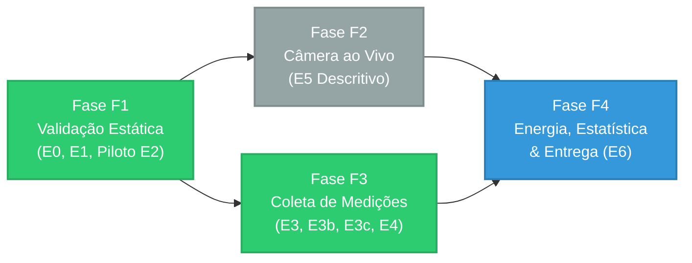
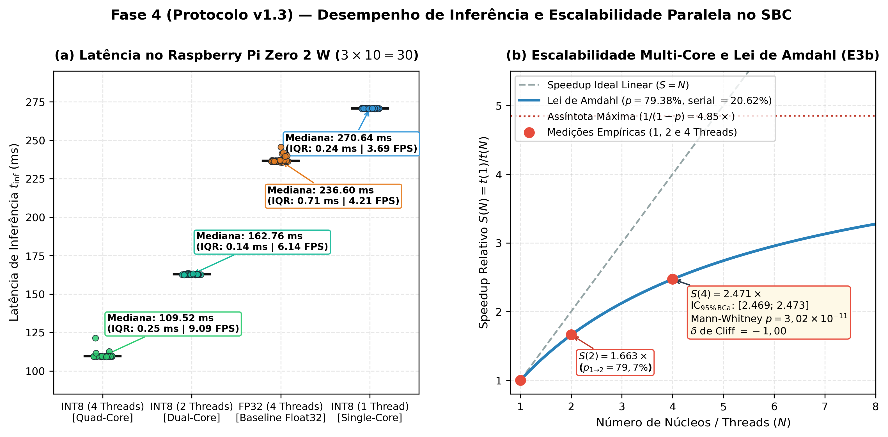
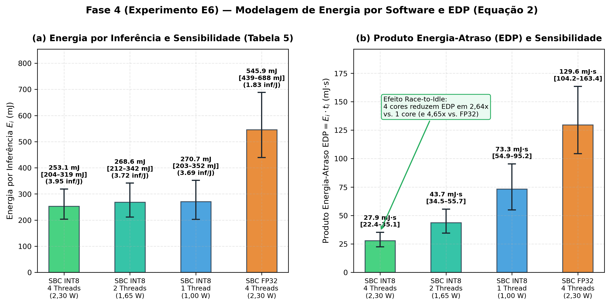
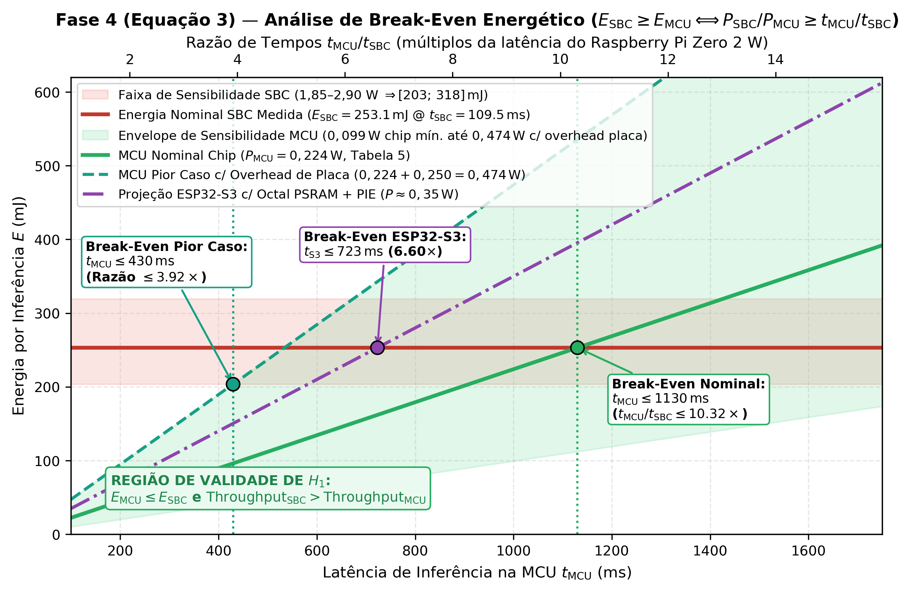
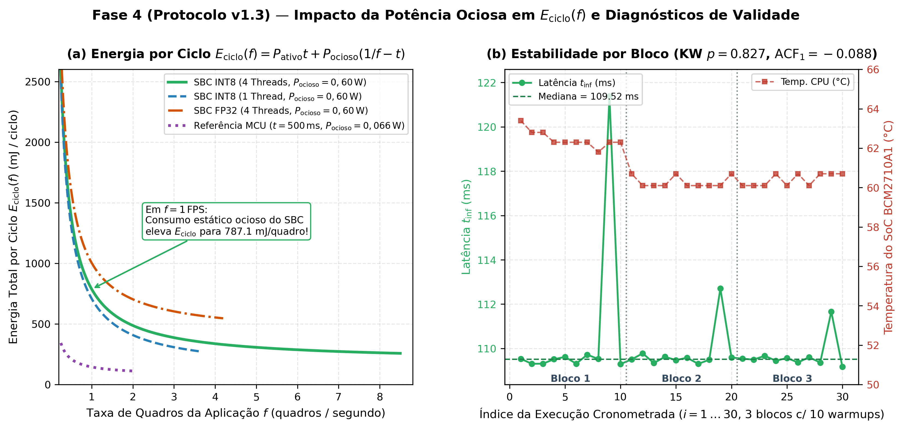
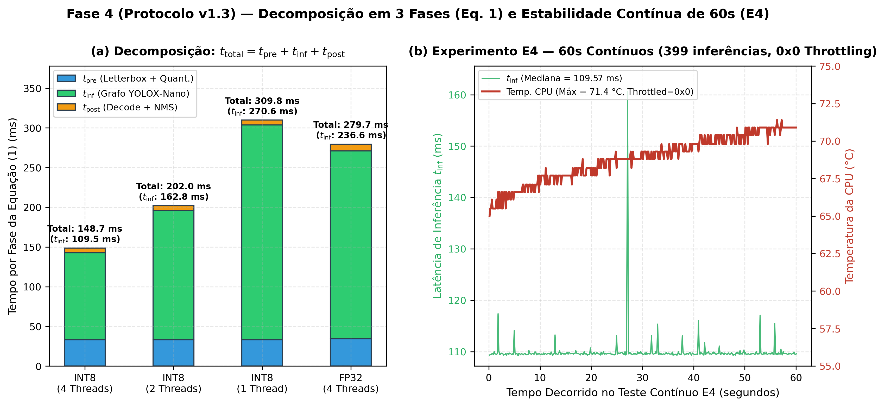

::: {.callout-note}
### Sobre este Documento (Sincronizado com `docs/protocolo.md` e `docs/projeto/main.pdf`)
Este roteiro operacional detalha as etapas de implementação, instrumentação por software, execução experimental e análise estatística/energética do projeto da trilha **PTT6 (Benchmarking e Eficiência Energética)**, atualizado conforme o **Protocolo Experimental v1.3–v1.4** aprovado na disciplina de Arquitetura e Organização de Computadores do PPCA/UFRR.
:::

::: {.callout-important}
### Principais Atualizações Metodológicas do Protocolo v1.3–v1.4
1. **Substituição da Medição Física (INA219) por Modelo de Energia Parametrizado em Software**: O sensor físico INA219 foi descartado por elevar excessivamente a complexidade e o risco de cronograma. A energia por inferência ($E_i$) passa a ser estimada analiticamente a partir dos tempos medidos por fase ($t_{\text{pre}}, t_{\text{inf}}, t_{\text{post}}$) e de um **modelo de potência por modo** baseado na literatura e datasheets, acompanhado de **análise de sensibilidade paramétrica**, cálculo de **EDP (*Energy-Delay Product*)**, **condição de *break-even*** e **energia por ciclo $E_{\text{ciclo}}(f)$**.
2. **Emenda de Hardware MCU (v1.1)**: Adotou-se o microcontrolador **ESP32 (Xtensa LX6, dual-core @ 240 MHz)** disponível em laboratório no lugar do ESP32-S3, declarando formalmente a ausência das extensões vetoriais PIE do S3 e ajustando a resolução comum $r \in \{416, 320, 256, 224, 160\}$ à memória disponível.
3. **Janela de Medição em Três Fases (`pré + inferência + pós`)**: Seguindo Noronha et al. (2025), registram-se separadamente $t_{\text{pre}}$ (cópia e quantização do tensor `uint8` em *letterbox* para `int8`), $t_{\text{inf}}$ (`Invoke()`) e $t_{\text{post}}$ (decodificação YOLOX + NMS por classe), utilizando relógios monotônicos de software (`time.perf_counter_ns()` no SBC e `esp_timer_get_time()` na MCU) sem E/S dentro da janela.
4. **Desenho Experimental em Blocos (`E0` a `E6`) e Estatística Robusta**: Definição empírica de *warm-up* ($W$) e tamanho amostral ($N_{\text{final}} = \max(30, N)$) via piloto (`E2`), coleta em 3 blocos independentes intercalados (`E3`), testes nos **Blocos A (1 classe: `vest`)** e **B (11 classes)**, e análise via **Mann-Whitney U**, **$\delta$ de Cliff**, **bootstrap BCa (10.000 reamostras)**, **Kruskal-Wallis** (efeito de bloco) e **ACF lag 1**.
:::

---

# Visão Geral e Alinhamento do Projeto (v1.3–v1.4)

## Identificação do Projeto
- **Título**: Benchmarking de Inferência do YOLO Quantizado em MCU e SBC: Desempenho e eficiência energética do YOLOX-Nano int8 para detecção de EPIs em Edge AI.
- **Discentes**: Filipe Matias e Guilherme Lucas.
- **Orientador**: Prof. Dr. Herbert Oliveira Rocha.
- **Trilha de PTT**: PTT6 — Benchmarking e Eficiência Energética (Protocolo Experimental v1.3–v1.4).
- **Produto Principal**: Relatório técnico conclusivo em formato de artigo científico.
- **Produto Secundário**: Repositório versionado (licença MIT) e dataset com medições brutas em CSV e metadados (com depósito previsto no Zenodo).

## Pergunta de Pesquisa e Hipóteses
- **Pergunta de Pesquisa**: Como se comparam latência, throughput e energia por inferência entre uma MCU (**ESP32 LX6**) e um SBC (**Raspberry Pi Zero 2 W**) ao executar o mesmo **YOLOX-Nano `int8`** na detecção de EPIs?
- **Hipótese Alternativa ($H_1$)**: O SBC apresenta *throughput* maior ($\text{throughput}_{\text{SBC}} > \text{throughput}_{\text{MCU}}$), mas energia por inferência igual ou superior ($E_{\text{SBC}} \ge E_{\text{MCU}}$), dado o seu consumo estático mais alto.
- **Hipótese Nula ($H_0$)**: Não há diferença nas métricas entre as plataformas.

## Objetivos
- **Objetivo Geral**: Comparar desempenho e eficiência energética da inferência do YOLOX-Nano `int8` em uma MCU e em um SBC.
- **Objetivos Específicos**:
  1. Preparar um artefato único `.tflite` `int8` (variante `ti-lite` amigável à quantização, com hash SHA-256 registrado) e validar sua equivalência funcional nas duas plataformas (`E0`, `E1`);
  2. Medir latência por fase ($t_{\text{pre}}, t_{\text{inf}}, t_{\text{post}}, t_{\text{total}}$), *throughput* e acurácia (`mAP@50`, `mAP@50-95`) sob protocolo controlado (`E2`, `E3`, `E3b`, `E3c`, `E4`, `E5`);
  3. Estimar a energia por inferência ($E_i$), inferências por joule e EDP por um modelo de potência parametrizado, quantificando sua sensibilidade e condição de *break-even* (`E6`);
  4. Testar $H_1$ com estatística não-paramétrica robusta (teste de interseção-união com Mann-Whitney U, $\delta$ de Cliff e IC 95% via bootstrap BCa) e publicar os dados brutos (CSV) e o código.

## Vínculo com a Disciplina de Arquitetura de Computadores
1. **Desempenho e Lei de Amdahl**: Comparação de tempos entre arquiteturas distintas (Xtensa LX6 vs. ARM Cortex-A53) e avaliação empírica da fração paralelizável nos 4 núcleos do SBC (`E3b`: 1, 2 e 4 threads).
2. **Hierarquia de Memória**: Impacto de SRAM/PSRAM da MCU frente à memória LPDDR2 de 512 MB e caches L1/L2 do SBC na definição da resolução máxima viável $r$ e no tempo de acesso aos tensores.
3. **Subsistemas de E/S e Energia**: Relação entre potência ativa, potência ociosa (consumo estático do SO e periféricos) e tempo de processamento na eficiência energética global e no produto energia-atraso (EDP).

---

# Materiais, Plataformas e Conjunto de Dados

## Plataformas Comparadas (Fator Independente)

| Característica | MCU (Emenda v1.1) | SBC |
| :--- | :--- | :--- |
| **Dispositivo** | **ESP32 (Xtensa LX6, dual-core)** | **Raspberry Pi Zero 2 W (ARM Cortex-A53, 4 núcleos)** |
| **Clock / Governador** | 240 MHz fixo (sem DFS / sem *light-sleep*) | 1,0 GHz fixo, governador `performance` |
| **Memória** | 520 KB SRAM interna (+ PSRAM externa conforme módulo) | 512 MB LPDDR2 SDRAM |
| **Runtime** | TensorFlow Lite Micro (`int8`) | TFLite / LiteRT (`ai-edge-litert` `int8`), 4 threads |
| **Alimentação** | USB 5 V (tensão nominal do chip: 3,3 V) | Fonte 5 V / 2,5 A |

> **Nota sobre a Emenda v1.1**: A proposta original citava o ESP32-S3; adotou-se o ESP32 (Xtensa LX6) disponível, sem as extensões vetoriais PIE do S3. Os resultados obtidos na MCU referem-se estritamente à arquitetura LX6 e não se extrapolam para o ESP32-S3.

## Modelo e Conjunto de Dados (Blocos A e B)
- **Modelo**: YOLOX-Nano (variante `ti-lite` amigável à quantização, $\approx 0{,}91\,\text{M}$ parâmetros e $1{,}08\,\text{GFLOPs}$ a $416 \times 416$), treinado uma única vez por configuração de classes no split de treino e quantizado pós-treino em `int8` *full-integer* com calibração estratificada. O mesmo arquivo `.tflite` (com hash SHA-256 auditado) é executado nas duas plataformas.
- **Conjunto de Dados**: *Ultralytics Construction-PPE* (AGPL-3.0), composto por 11 classes (`helmet, gloves, vest, boots, goggles, none, Person, no_helmet, no_goggle, no_gloves, no_boots`).
  - **Bloco A**: Configuração de **1 classe** (`vest` — colete).
  - **Bloco B**: Configuração completa de **11 classes**.

| Split | Total de Imagens | Instâncias da classe `vest` | Imagens contendo `vest` |
| :--- | :---: | :---: | :---: |
| **Treino** | 1.142 (1.132 válidas) | 1.283 | 837 |
| **Validação** | 143 | 171 | 109 |
| **Teste** | 141 | 178 | 111 |

---

# Metodologia Experimental e Instrumentação por Software

## Estratégia em Quatro Fases com Critério de Saída

## Variáveis do Experimento

| Tipo | Variáveis |
| :--- | :--- |
| **Independente** | Plataforma $\in \{\text{MCU}, \text{SBC}\}$ |
| **Dependentes** | Tempos por fase $t_{\text{pre}}, t_{\text{inf}}, t_{\text{post}}$ e latência ponta a ponta $t_{\text{total}}$ ($\text{ms}$); *throughput* ($\text{inf/s}$); energia por inferência $E$ ($\text{mJ}$); eficiência ($\text{inferências/J}$); $\text{EDP}$ ($\text{mJ}\cdot\text{ms}$); acurácia (`mAP@50` e `mAP@50-95`). |
| **Controladas** | Artefato `.tflite` (hash SHA-256), resolução comum $r$, quantização `int8`, limiares ($\text{conf} \ge 0{,}25$; $\text{IoU}_{\text{NMS}} = 0{,}45$; máx. 100 detecções), mesmas 50 imagens de entrada em *letterbox*, clock/governor, número de threads, rádio e alimentação. |
| **Covariáveis** | Temperatura da CPU, frequência real e flag de *throttling* (no SBC), temperatura ambiente, nº de detecções na imagem, índice da imagem, bloco e ordem de execução. |

## Pipeline e Janela de Medição (`pré + inferência + pós`)
A janela de medição abrange o ciclo completo ponta a ponta dividido em três fases cronometradas separadamente em memória (sem chamadas de E/S, print ou disco dentro da janela):

1. **Pré-processamento ($t_{\text{pre}}$)**: As entradas estáticas são tensores brutos $r \times r \times 3$ em `uint8` já redimensionados com *letterbox* (idênticos byte a byte no SBC e na MCU). O tempo $t_{\text{pre}}$ mede exatamente a cópia e a quantização afim (`uint8 -> int8`, $q = \text{round}(x / \text{scale}) + zp$) para o buffer de entrada do interpretador.
2. **Inferência ($t_{\text{inf}}$)**: Execução exclusiva do operador de inferência do grafo (`interpreter.invoke()` no LiteRT / `interpreter->Invoke()` no TFLM).
3. **Pós-processamento ($t_{\text{post}}$)**: Decodificação das grades de saída `int8` do YOLOX (conversão para coordenadas de caixas e scores de classes) seguida da Supressão Não-Máxima (**NMS por classe**, com limiar de confiança $\ge 0{,}25$, $\text{IoU}_{\text{NMS}} = 0{,}45$ e limite de até 100 detecções), implementada com a mesma lógica algorítmica nas duas plataformas.
4. **Latência Total ($t_{\text{total}}$)**:
   $$t_{\text{total},i} = t_{\text{pre},i} + t_{\text{inf},i} + t_{\text{post},i}$$

### Escolha da Resolução Comum $r$
A resolução espacial $r$ é selecionada como a maior dentre $\{416, 320, 256, 224, 160\}$ que caiba na memória disponível do ESP32 e permita executar ao menos 30 inferências por bloco em até 60 minutos. Quando $r < 416$, o experimento exploratório **`E3c`** avalia adicionalmente o SBC na resolução nominal de $416 \times 416$.

## Matriz de Experimentos (`E0` a `E6`)

| ID | Fase | Descrição e Saída Esperada |
| :---: | :---: | :--- |
| **`E0`** | F1 | **Acurácia offline `fp32` $\times$ `int8`** no conjunto de teste (141 imagens), por resolução $r$: `mAP@50` e `mAP@50-95`. |
| **`E1`** | F1 | **Equivalência funcional**: mesmas 50 entradas em PC, SBC e MCU; verificação de mesmas classes, nº de detecções, $\text{IoU} \ge 0{,}95$ e $|\Delta\text{score}| \le 1$ passo de quantização. |
| **`E2`** | F1/F3 | **Piloto**: viabilidade de $r$ na MCU; 100 inferências por plataforma; determinação empírica do *warm-up* $W$ e do tamanho amostral $N_{\text{final}}$. |
| **`E3`** | F3 | **Benchmark principal estático**: 3 blocos independentes por plataforma, $N = \max(30, N_{\text{piloto}})$, percorrendo as 50 entradas em ordem fixa. |
| **`E3b`** | F3 | **Escalabilidade multi-core (Lei de Amdahl)**: SBC com 1, 2 e 4 threads (exploratório). |
| **`E3c`** | F3 | **Desempenho em resolução cheia no SBC**: SBC a $416 \times 416$ quando $r < 416$ (exploratório). |
| **`E4`** | F3 | **Throughput sustentado e deriva térmica**: execução contínua em laço fechado por 60 s. |
| **`E5`** | F2 | **Pegada de memória / Câmera ao vivo**: Uso de Flash/RAM e FPS sustentado (descritivo). |
| **`E6`** | F4 | **Energia derivada por software, análise de sensibilidade e *break-even*** (Fase 4). |

### Regra de *Warm-up* ($W$) e Tamanho Amostral ($N_{\text{final}}$) no Piloto (`E2`)
- **Warm-up ($W$)**: Em janelas sucessivas de 10 inferências do piloto, descartam-se as janelas iniciais até que a variação relativa da mediana entre janelas consecutivas fique abaixo de $2\%$ por duas janelas seguidas, respeitando o piso mínimo de $W \ge 5$ inferências.
- **Número de Repetições ($N_{\text{final}}$)**: A partir do coeficiente de variação ($\text{CV} = s / \bar{x}$) de $t_{\text{total}}$ medido no piloto, calcula-se:
  $$N = \left\lceil \left( \frac{1{,}96 \cdot \text{CV}}{\varepsilon} \right)^2 \right\rceil, \quad \varepsilon = 1\%, \quad N_{\text{final}} = \max(30, N)$$

---

# Fase 4: Modelo de Energia por Software, Sensibilidade e Análise Estatística (`E6`)

## Modelo Parametrizado de Potência e Energia (`E6`)
Com o descarte do sensor físico INA219, a energia consumida na $i$-ésima inferência ($E_i$, em milijoules $\text{mJ}$ quando $P$ está em Watts e $t$ em milissegundos) é calculada por software através de:

$$E_i = P_{\text{pre}}\,t_{\text{pre},i} + P_{\text{inf}}\,t_{\text{inf},i} + P_{\text{post}}\,t_{\text{post},i}$$

### Parâmetros do Modelo de Potência (Tabela 5 do Protocolo v1.3)

| Plataforma | Modo de Operação | Potência Nominal ($P_{\text{nom}}$) | Faixa de Sensibilidade ($[P_{\min}, P_{\max}]$) | Fonte / Referência |
| :--- | :--- | :---: | :---: | :--- |
| **SBC (placa, 5 V)** | Ocioso (*idle*) | **0,60 W** | $0{,}50\text{ – }1{,}00\,\text{W}$ | CNX Software [6]; Geerling [7] |
| **SBC (placa, 5 V)** | Ativo, 1 núcleo | **1,00 W** | $0{,}75\text{ – }1{,}30\,\text{W}$ | Geerling [7] |
| **SBC (placa, 5 V)** | Ativo, 4 núcleos | **2,30 W** | $1{,}85\text{ – }2{,}90\,\text{W}$ | Geerling [7]; Tom's Hardware [8] |
| **MCU (chip, 3,3 V)** | Ativo, 240 MHz | **0,224 W** | $0{,}099\text{ – }0{,}224\,\text{W}$ | Espressif ESP32 Datasheet v5.3 [9] |
| **MCU (placa)** | *Overhead* da placa ($\Delta P_{\text{placa}}$) | **0,00 W** | $0{,}00\text{ – }0{,}25\,\text{W}$ | Parâmetro declarado de sensibilidade |

> **Nota sobre o *overhead* de placa da MCU**: Como as medições de referência do SBC abrangem a placa completa (5 V) e os dados de datasheet do ESP32 referem-se ao chip (3,3 V), a hipótese $H_1$ é avaliada tanto no cenário nominal ($\Delta P_{\text{placa}} = 0\,\text{W} \Rightarrow P_{\text{MCU}} = 0{,}224\,\text{W}$) quanto no **pior caso para a MCU** ($\Delta P_{\text{placa}} = 0{,}25\,\text{W} \Rightarrow P_{\text{MCU,max}} = 0{,}474\,\text{W}$).

### Métricas Derivadas de Eficiência Energética
1. **Eficiência Energética ($\eta$)**:
   $$\eta_i = \frac{1000}{E_i} \quad [\text{inferências / Joule}]$$
2. **Produto Energia-Atraso (*Energy-Delay Product* — EDP)**:
   $$\text{EDP}_i = E_i \cdot t_{\text{total},i} \quad [\text{mJ}\cdot\text{ms}]$$
3. **Condição de *Break-Even* Energético**:
   Como a potência ativa é constante em cada modo ($P_{\text{pre}} = P_{\text{inf}} = P_{\text{post}} = P_{\text{ativo}}$), a energia reduz-se à transformação linear $E = P_{\text{ativo}} \cdot t_{\text{total}}$. A condição para que o SBC consuma energia igual ou superior à MCU ($E_{\text{SBC}} \ge E_{\text{MCU}}$) é dada pela razão crítica:
   $$E_{\text{SBC}} \ge E_{\text{MCU}} \iff \frac{P_{\text{SBC}}}{P_{\text{MCU}}} \ge \frac{t_{\text{MCU}}}{t_{\text{SBC}}}$$
   A análise reporta explicitamente a razão de tempos observada ($t_{\text{MCU}} / t_{\text{SBC}}$) e verifica se a razão de potências $[P_{\text{SBC,min}} / P_{\text{MCU,max}},\, P_{\text{SBC,max}} / P_{\text{MCU,min}}]$ permanece acima do limiar de *break-even*.
4. **Energia por Ciclo em Aplicação Periódica ($E_{\text{ciclo}}(f)$)**:
   Para uma taxa de amostragem de vídeo de $f$ quadros por segundo (válido para $t_{\text{total}} < 1/f$):
   $$E_{\text{ciclo}}(f) = P_{\text{ativo}}\,t_{\text{total}} + P_{\text{ocioso}}\left(\frac{1}{f} - t_{\text{total}}\right)$$

## Protocolo de Análise Estatística Robusta (Seção 4.7)
- **Estatística Descritiva por Plataforma**: Mediana e intervalo interquartil (IQR), média $\pm$ desvio-padrão ($s$) e coeficiente de variação ($\text{CV}$).
- **Testes de Hipótese e Tamanho de Efeito**:
  - **Teste U de Mann-Whitney**: Bilateral para comparação de latência e unilateral nas direções previstas por $H_1$ ($\text{throughput}_{\text{SBC}} > \text{throughput}_{\text{MCU}}$ e $E_{\text{SBC}} \ge E_{\text{MCU}}$).
  - **Teste de Interseção-União (IUT)**: $H_1$ só é confirmada se ambas as partes rejeitarem suas respectivas hipóteses nulas a $\alpha = 0{,}05$, avaliando a componente energética no valor nominal e nos extremos da Tabela 5.
  - **$\delta$ de Cliff**: Quantificação não-paramétrica da magnitude do efeito ($\delta \in [-1, +1]$).
  - **Bootstrap BCa (10.000 reamostras)**: Intervalos de confiança de 95% para a diferença e para a razão das medianas entre plataformas.
- **Diagnósticos de Validade Interna**:
  - **Outliers**: Mantidos na análise principal; remoção pelo critério de Tukey ($1{,}5 \times \text{IQR}$) reportada exclusivamente como análise de sensibilidade.
  - **Efeito de Bloco**: Teste de **Kruskal-Wallis** entre os 3 blocos independentes de `E3`.
  - **Dependência Temporal**: Autocorrelação serial de **lag 1 (ACF-1)** da série temporal de latências.
  - **Isolamento de Linguagem/Implementação**: Análise secundária utilizando exclusivamente $t_{\text{inf}}$ para isolar o núcleo de inferência (TFLM C++ vs. LiteRT C++ via binding Python) de eventuais diferenças de implementação em $t_{\text{pre}}$ e $t_{\text{post}}$.

---

# Progresso Realizado e Resultados Experimentais já Obtidos

## Fase F1 — Treinamento, Exportação ONNX e Quantização INT8
- **Fine-Tuning YOLOX-Nano (Bloco B — 11 classes, $416 \times 416$)**: 80 épocas concluídas na GPU RTX 4050, atingindo **59,9% de mAP@50** e **29,0% de mAP@[0.50:0.95]**.
- **Modelos Exportados (`models/`)**:
  - `models/yolox_nano_ppe_raw.onnx` (3,6 MB, opset 13).
  - [`models/yolox_nano_ppe_float32.tflite`](../models/yolox_nano_ppe_float32.tflite) (3,5 MB, baseline FP32).
  - [`models/yolox_nano_ppe_int8.tflite`](../models/yolox_nano_ppe_int8.tflite) (1,2 MB, Full INT8).
  - [`firmware/esp32/esp_idf/main/model_data.h`](../firmware/esp32/esp_idf/main/model_data.h) (header C alinhado em 16 bytes).

## Fase F3 — Resultados Experimentais Completos no SBC (Protocolo v1.3: `E0`, `E1`, `E2`, `E3b`, `E3c`, `E4` e `E5`)

No Raspberry Pi Zero 2 W (Debian 13 Trixie 64-bit, governador `performance` @ 1,0 GHz, runtime `ai-edge-litert` v2.3.0 com delegate XNNPACK NEON), **todos os experimentos previstos no Protocolo v1.3** foram executados via [`raspberry/pi_zero_2w/benchmark_yolox.py`](../raspberry/pi_zero_2w/benchmark_yolox.py) e [`raspberry/pi_zero_2w/run_all_v13_experiments.py`](../raspberry/pi_zero_2w/run_all_v13_experiments.py), em **3 blocos independentes de 10 execuções ($n = 30$) com 10 *warmups* descartados por bloco**, cronometrando separadamente $t_{\text{pre}}$, $t_{\text{inf}}$, $t_{\text{post}}$ e $t_{\text{total}}$.

## Fase F4 — Modelagem Energética (`E6`), Estatística Robusta e Figuras Científicas (`report/figures/`)

Os módulos [`telemetry/energy_and_stats_v13.py`](../telemetry/energy_and_stats_v13.py) e [`telemetry/plot_phase4_v13.py`](../telemetry/plot_phase4_v13.py) consolidam os resultados quantitativos em [`data/processed/phase4_e6_report.json`](../data/processed/phase4_e6_report.json) e [`data/processed/phase4_energy_stats_summary.csv`](../data/processed/phase4_energy_stats_summary.csv), gerando **5 figuras científicas** (PNG 300 DPI + PDF vetorial):

### Figura 1 — Desempenho de Inferência e Escalabilidade Multi-Core (1, 2 e 4 Threads — Lei de Amdahl)

### Figura 2 — Energia por Inferência, Análise de Sensibilidade (Tabela 5) e Produto Energia-Atraso (EDP)

### Figura 3 — Espaço de *Break-Even* Energético MCU vs. SBC (Incluindo Projeção para o ESP32-S3)

### Figura 4 — Energia por Ciclo em Regime Periódico $E_{\text{ciclo}}(f)$ e Diagnósticos de Validade Interna (3 Blocos)

### Figura 5 — Decomposição em 3 Fases ($t_{\text{pre}} + t_{\text{inf}} + t_{\text{post}}$) e Estabilidade Contínua de 60 s (`E4`)

---

# Checklist de Conclusão de Etapas (Definition of Done — v1.3–v1.4)
- [x] Dataset Construction-PPE organizado e convertido para COCO JSON (11 classes + filtro Bloco A `vest`).
- [x] Modelo YOLOX-Nano treinado e exportado para ONNX (opset 13) e TFLite (`fp32` e `int8`).
- [x] Ambiente do Raspberry Pi Zero 2 W provisionado via USB/Wi-Fi com governador `performance` @ 1,0 GHz e `ai-edge-litert` v2.3.0.
- [x] Execução integral no SBC de todos os experimentos do **Protocolo v1.3**: `E0` (baseline ocioso), `E1` (sanidade da quantização), `E2` (dimensionamento $N$), `E3b` (**1, 2 e 4 threads** em 3 blocos com 10 warmups/bloco), `E3c` (INT8 vs. FP32 com decomposição $t_{\text{pre}}, t_{\text{inf}}, t_{\text{post}}$), `E4` (60 s contínuos sem pausa) e `E5` (pegada de Flash e RAM de pico).
- [x] Roteiro de implementação sincronizado com o **Protocolo Experimental v1.3–v1.4**.
- [x] Implementação do módulo da **Fase 4 (`E6`)** (`telemetry/energy_and_stats_v13.py`) e geração dos **5 conjuntos de figuras científicas** (`telemetry/plot_phase4_v13.py` $\to$ `report/figures/*.png` e `*.pdf`).
- [ ] Execução dos experimentos físicos na MCU assim que o **ESP32-S3** for disponibilizado pelo orientador (ou em placa ESP32 LX6 de contingência) e atualização automática das figuras.
- [ ] Consolidação final do artigo e gravação do vídeo demonstrativo (3–5 minutos).

